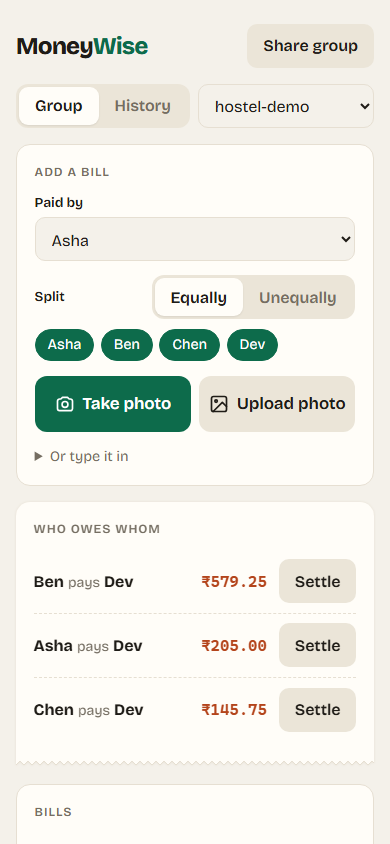
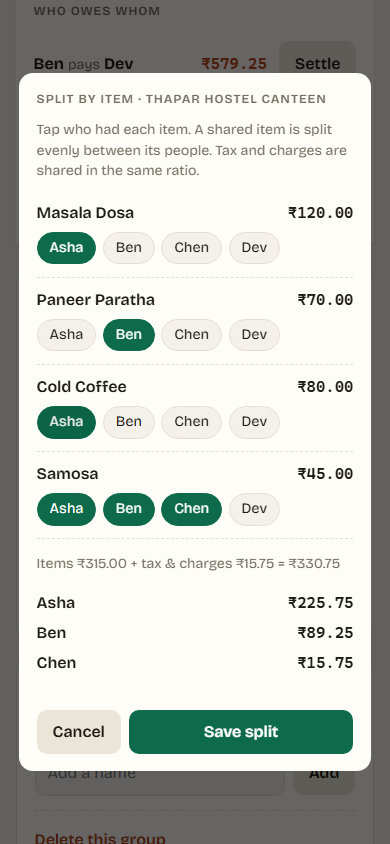
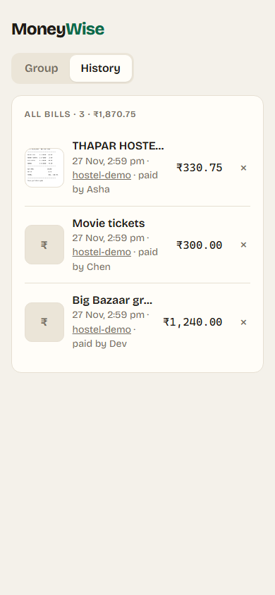
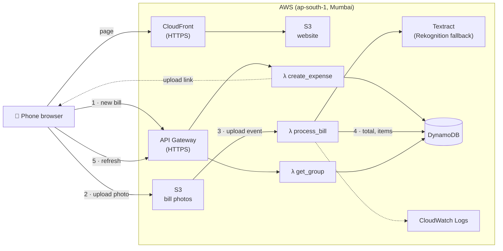

# MoneyWise

**Split hostel bills by snapping a photo.** Upload a picture of any bill. AWS reads the shop name, total and every item, splits it across your group, and keeps a running tally of who owes whom.

A fully **serverless** app on AWS: no servers to run, pay only for what you use (practically free at hostel scale).

🔗 **Live app:** https://dw0ogipq37qsd.cloudfront.net/ (served by CloudFront; backup link via API Gateway: https://wwvnnl82j1.execute-api.ap-south-1.amazonaws.com/)

| Group (phone) | Split by item | History |
|---|---|---|
|  |  |  |

---

## Contents

1. [The problem](#the-problem)
2. [Features](#features)
3. [How it works](#how-it-works)
4. [AWS services used](#aws-services-used)
5. [How the money is split](#how-the-money-is-split)
6. [Project structure](#project-structure)
7. [Run it yourself](#run-it-yourself)
8. [API reference](#api-reference)
9. [Testing](#testing)
10. [Cost](#cost)
11. [Limits and notes](#limits-and-notes)

---

## The problem

Roommates and friends share bills all the time: groceries, food orders, canteen dinners, trips. Typing every bill into an app is tedious, so people stop doing it and lose track of who owes whom.

**MoneyWise removes the typing:** take a photo, and the amount appears and is split about 3 seconds later.

## Features

| Feature | What it does |
|---|---|
| 📷 **Scan or upload a bill** | *Take photo* opens the camera, *Upload photo* picks from your gallery. The total, shop name and date are read automatically. |
| 🧾 **Split by item** | The individual items on the bill are read too. Tap who had what; shared items are split between those people, and tax is shared fairly. |
| ⚖️ **Equal or unequal split** | Split equally between chosen people, or unequally by ₹ amount or by parts (2 = double share). |
| 💸 **Who owes whom** | Balances are simplified into the fewest payments. *Settle* records a payment. |
| 👥 **Multiple groups** | Be in many groups (room, trip, office), each with its own members. Switch from the dropdown. |
| 🕘 **History** | Every bill from all your groups, newest first, with bill photos. |
| ✍️ **Manual entry** | Type an amount for things without a bill. |
| 🗑️ **Delete** | Delete a bill (and its photo), or a whole group for everyone (type its code to confirm). |
| 📱 **Phone first** | Works in any phone browser over HTTPS. Dark mode supported. Typed drafts survive switching tabs. |

## How it works



Step by step, when you scan a bill:

1. **Create:** the page asks the API for a new bill. `create_expense` saves it in DynamoDB as *processing* and returns a one-time upload link (a *presigned URL*, valid 5 minutes).
2. **Upload:** the phone shrinks the photo to about 2000 px and uploads it straight to S3. It never passes through a server.
3. **Event:** S3 fires an *ObjectCreated* event, which starts `process_bill`. This is the **event-driven** part: nothing polls S3.
4. **Read:** `process_bill` sends the photo to **Textract** (`AnalyzeExpense`), which returns the shop, date, total and line items, and saves them on the bill. *Right now Textract is waiting on AWS account verification, so the same function automatically uses **Rekognition** (`DetectText`) and rebuilds the bill's rows itself. It switches back to Textract on its own once the account is verified.*
5. **Show:** the page refreshes every 1.5 s while a bill is processing. `get_group` returns the bills, balances and who-pays-whom.

## AWS services used

| Service | Used for | Syllabus topic |
|---|---|---|
| **AWS Lambda** (Python 3.12) | 7 small functions, all in [`src/app.py`](src/app.py) | Serverless computing, FaaS |
| **Amazon API Gateway** (HTTP API) | HTTPS entry point for the API **and** the website | Managed APIs |
| **Amazon S3** | Website hosting + bill photo storage (photos auto-delete after 1 year) | Cloud object storage |
| **Amazon Textract** | Reads total, shop, date and line items from bill photos (built in; active once AWS verifies the account) | AI / ML as a service |
| **Amazon Rekognition** | Reads the bills today, while Textract is unavailable on the account | AI / ML as a service |
| **Amazon DynamoDB** | All bills and group members in one table, pay-per-request | NoSQL database |
| **Amazon CloudWatch** | Logs from every function, including what was read from each bill | Monitoring |
| **AWS SAM / CloudFormation** | The whole setup is defined in one file: [`template.yaml`](template.yaml) | Infrastructure as Code |
| **Amazon CloudFront** | CDN in front of the website: HTTPS and fast loading from Indian edge locations | Content delivery |

<details>
<summary><b>The 7 Lambda functions</b></summary>

| Function | Trigger | Job |
|---|---|---|
| `create_expense` | `POST /expenses` | Save a new bill; return a photo upload link, or save a typed amount directly |
| `process_bill` | S3 upload event | Read the photo with Textract (or Rekognition), save total and items |
| `get_group` | `GET /groups/{group}` | Return members, bills (with photo links), balances, who-pays-whom |
| `assign_items` | `POST /groups/{group}/expenses/{id}/items` | Save who had which item; recompute the split |
| `delete_expense` | `DELETE /groups/{group}/expenses/{id}` | Delete one bill and its photo |
| `delete_group` | `DELETE /groups/{group}` | Delete a group: all bills, members and photos |
| `update_members` | `POST /groups/{group}/members` | Add or remove a person (atomic, so two phones can't overwrite each other) |

</details>

<details>
<summary><b>Data model (one DynamoDB table)</b></summary>

| `groupId` (partition key) | `expenseId` (sort key) | Other fields |
|---|---|---|
| `room-204` | `#meta` | `members` (set of names) |
| `room-204` | `1795717345914-39c5974d` | `payer`, `members`, `weights`, `total` (paise), `vendor`, `date`, `items`, `assign`, `status`, `photo` |

A bill id starts with its creation time in milliseconds, so bills sort newest-first for free. All money is stored as whole **paise** (₹330.75 → `33075`) so there are no rounding errors.

</details>

## How the money is split

**Equal:** ₹100 among 3 people → ₹33.34, ₹33.33, ₹33.33. Leftover paise go to the first people, so the shares always add up exactly.

**Unequal:** each person gets a *weight* (their ₹ amount or their parts), and the total is shared in that ratio.

**By item:** each person's weight is the total of the items they had (a shared item is split evenly between its people). The **bill total, including tax and service charge, is then shared in that ratio**, so everyone pays tax only on what they ate.

> **Worked example: canteen bill, total ₹330.75 (items ₹315 + 5% GST ₹15.75)**
>
> | Item | Price | Who had it |
> |---|---|---|
> | Masala Dosa | ₹120 | Asha |
> | Paneer Paratha | ₹70 | Ben |
> | Cold Coffee | ₹80 | Asha |
> | Samosa | ₹45 | Asha, Ben, Chen |
>
> Item totals: Asha ₹215, Ben ₹85, Chen ₹15. Each share of ₹330.75 is item total ÷ 315:
> **Asha ₹225.75 · Ben ₹89.25 · Chen ₹15.75** (adds up to exactly ₹330.75).

**Who owes whom:** everyone's net balance (paid − owed) is reduced to the fewest payments by matching the biggest debtor with the biggest creditor.

## Project structure

```
MoneyWise/
├── template.yaml        # every AWS resource (SAM / CloudFormation)
├── deploy.ps1           # one-command deploy + website upload
├── src/
│   └── app.py           # all 7 Lambda functions + the splitting logic
├── web/
│   └── index.html       # the entire website (one file, no frameworks)
├── test_app.py          # tests for reading bills, splitting and balances
└── docs/screenshots/    # images used in this README
```

## Run it yourself

**You need:** an AWS account, [AWS CLI](https://aws.amazon.com/cli/), [AWS SAM CLI](https://docs.aws.amazon.com/serverless-application-model/latest/developerguide/install-sam-cli.html), Python 3, Windows PowerShell.

1. **Create an access key.** In the AWS Console go to IAM → Users → Create user, attach **AdministratorAccess**, then Security credentials → Create access key → *CLI*.
2. **Log in from your PC:**
   ```powershell
   aws configure          # paste the key; region: ap-south-1
   ```
3. **Deploy everything** (takes about 3 minutes the first time):
   ```powershell
   powershell -ExecutionPolicy Bypass -File .\deploy.ps1
   ```
4. **Open the printed `Site:` link on your phone.** Make up a group code (e.g. `room-204`), add names, scan a bill.
5. **Add CloudFront (one time, in the console).** CloudFront → *Create distribution*:
   - *Single website configuration*, name `moneywise`
   - Origin type **Other**, origin domain = the `WebsiteUrl` output without `http://` (e.g. `moneywise-websitebucket-xxxx.s3-website.ap-south-1.amazonaws.com`)
   - *Customize origin settings* → Protocol **HTTP only** (the S3 website endpoint has no HTTPS); recommended cache settings
   - Security: *Do not enable security protections* (WAF costs extra) → *Create distribution*

   After 5–15 minutes the `xxxx.cloudfront.net` link works. From then on `deploy.ps1` finds it and prints it as the `Site:` link.

<details>
<summary><b>Troubleshooting</b></summary>

| Problem | Fix |
|---|---|
| `AccessDenied` on the website bucket policy | S3 → *Block Public Access settings for this account* → untick the two "bucket policies" boxes, then deploy again. |
| `explicit deny in a service control policy` | The account belongs to an organization (e.g. a college account) that blocks these services. Use a personal AWS account. |
| Bills read by Rekognition instead of Textract | New accounts often can't use Textract until AWS verifies them. Nothing to change: Textract is used automatically once it works. |
| `Your account must be verified before you can add new CloudFront resources` | Seen when CloudFormation creates the distribution on a new account. Creating it in the console (step 5) worked for us; otherwise open an AWS Support case (*Account and billing → Other Account Issues*). The API Gateway link works meanwhile. |

</details>

**Tear down:** in CloudFront, *Disable* then *Delete* the distribution; empty both S3 buckets; then `sam delete --stack-name moneywise`.

## API reference

Base URL: `https://<api-id>.execute-api.ap-south-1.amazonaws.com`. All bodies are JSON. Money is in **paise** in responses and **rupees** in requests.

| Method | Path | Body | Result |
|---|---|---|---|
| `GET` | `/groups/{group}` | | members, bills, balances, settlements |
| `POST` | `/expenses` | `{group, payer, members, weights?, amount?, note?}` | no `amount`: returns `uploadUrl` for the photo |
| `POST` | `/groups/{group}/expenses/{id}/items` | `{assign: [["Asha"], ["Ben","Chen"], …]}` | one list of names per item |
| `DELETE` | `/groups/{group}/expenses/{id}` | | deletes the bill and its photo |
| `POST` | `/groups/{group}/members` | `{add: "Name"}` or `{remove: "Name"}` | |
| `DELETE` | `/groups/{group}` | | deletes the whole group |

The API is rate-limited to 10 requests/second (burst 40) to protect against runaway bills.

## Testing

```powershell
python test_app.py
```

It checks the logic that matters most, without needing AWS:

- reading amounts like `Rs. 1,234.50`, and picking the grand total over the subtotal
- extracting items from both Textract and Rekognition output (using the real layout of a scanned bill)
- equal, unequal and item-wise splits always adding up to the exact paisa
- balances and settle-up reaching zero
- rejecting bad input (negative amounts, empty item assignments, wrong group codes)

## Cost

Within the AWS Free Tier, a hostel group's usage costs close to nothing:

| Service | Typical monthly use | Cost |
|---|---|---|
| Lambda, API Gateway, DynamoDB, S3 | a few thousand requests | free tier |
| Textract / Rekognition | about 1 page per bill | ~₹1 per bill after the free tier |
| CloudFront | a few hundred page loads | free (1 TB/month free) |

Tip: set a **Zero spend budget** (AWS Console → Budgets) to get an email if anything ever costs money.

## Limits and notes

- **No login.** Anyone with a group code can see and edit that group. Pick a code that's hard to guess.
- **History is per device:** it lists the groups opened on that phone or browser.
- **Rekognition fallback reads at most 100 words per photo**, so very long bills may lose items. Textract has no such limit.
- **Item detection is best effort** on crumpled or blurry bills. You can always fall back to an equal or unequal split.
- **HTTPS:** S3 website hosting is HTTP-only and phone browsers refuse plain HTTP, so the site is served over HTTPS by CloudFront (origin: the S3 website endpoint, origin protocol HTTP only). The distribution was created in the console; the API Gateway link serves the same site as a backup.
